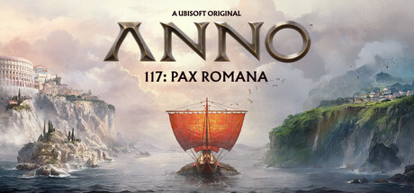

**Anno 117: Pax Romana by Ubisoft Mainz (2025) brings the beloved city-builder series to ancient Rome.**

---

## 📖 About

Anno 117: Pax Romana by Ubisoft Mainz (2025) brings the beloved city-builder series to ancient Rome. You manage Roman citizens' needs across tiers — from plebeians to patricians — while conducting military campaigns and trading across the Mediterranean.

## ⚠️ Problems Without Trainer

| Problem | Status |
|---------|--------|
| Patrician tier needs require supply chains that span multiple island colonies | ✅ Solved |
| Military campaigns demand resource stockpiles that drain civil construction | ✅ Solved |
| Trade route profits insufficient to offset expensive early infrastructure | ✅ Solved |
| Population satisfaction drops cascade from single supply chain interruption | ✅ Solved |
| Festival and monument costs require extremely long wealth accumulation phases | ✅ Solved |

## ✅ Solution

The **Anno 117: Pax Romana Trainer** solves all these issues, giving you complete control so you can focus on enjoying the game.

## 🎯 Features

- Unlimited Resources / Currency
- God Mode / Invincibility
- Instant Skill & Ability Cooldown
- One-Hit Kill
- Freeze Timers
- Unlock All Items & Achievements
- Custom Speed Multiplier
- Infinite Stamina / Energy

## 🚀 Quick Start

1. **Disable Windows Defender** temporarily (trainer may trigger false positive)
2. Get the trainer from the button above
3. Launch Anno 117: Pax Romana
4. Run the trainer as Administrator
5. Use the hotkeys to activate cheats in-game

## 💎 Free vs Pro

| Feature | Free | Pro |
|---------|------|-----|
| God Mode | ✅ | ✅ |
| Unlimited Resources | ✅ | ✅ |
| Advanced Cheats | ❌ | ✅ |
| Auto-Updates | ❌ | ✅ |
| Priority Support | ❌ | ✅ |

## 💻 Requirements

- Windows 10 / 11 (64-bit)
- Anno 117: Pax Romana (any version)
- .NET Framework 4.8+
- DirectX 11+

## 🍎 macOS

## ⚖️ Legal

Educational and single-player use only.

---

